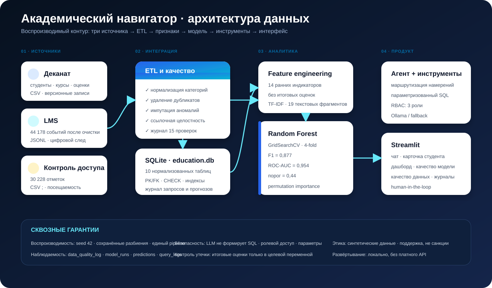

# ◈ Академический навигатор

**Интеллектуальный агент-аналитик академической успеваемости и риска неуспеваемости**  
Лабораторный комплекс по дисциплине «Управление данными», направление 09.03.03 «Прикладная информатика».

> Учебный воспроизводимый прототип на полностью синтетических данных. Система предназначена для ранней поддержки, а не для санкций или автоматического принятия решений.



## Что реализовано

- три независимых синтетических источника: деканат, LMS и система посещаемости;
- очистка, интеграция и контроль качества с аудитом каждого правила;
- нормализованная SQLite-БД, ER-диаграмма, PK/FK/CHECK/индексы;
- EDA, 14 признаков, защита от утечки цели, train/validation/test;
- локальная текстовая база знаний: 5 документов, 19 фрагментов и TF-IDF-векторный индекс;
- baseline, Logistic Regression и Random Forest с `GridSearchCV`;
- версия модели, прогнозы, приближённые локальные объяснения и карточка модели;
- агент с параметризованными SQL-инструментами и ролевым доступом;
- локальная LLM Ollama как необязательный слой формулировки, безопасный fallback без API;
- Streamlit: чат, карточка студента, дашборд, метрики модели и качество данных;
- журнал запросов, автоматические тесты, полный отчёт и презентация.

## Результаты контрольного запуска

| Показатель | Значение |
|---|---:|
| Студентов / дисциплин | 420 / 6 |
| Событий LMS после очистки | 44 178 |
| Отметок посещаемости после очистки | 30 228 |
| Доля целевого класса | 34,5% |
| Выбранная модель | Random Forest (GridSearchCV) |
| F1 на независимом тесте | **0,877** |
| Recall | **0,862** |
| Precision | **0,893** |
| ROC-AUC | **0,954** |
| Тестовая выборка | 84 наблюдения |

Метрики относятся только к синтетическому набору и не подтверждают применимость к реальным студентам.

## Быстрый запуск

Требуется Python 3.11+ (протестировано также на Python 3.13).

### Linux / macOS

```bash
git clone https://github.com/20Artem04/edu-risk-agent.git
cd edu-risk-agent
python -m venv .venv
source .venv/bin/activate
pip install -r requirements.txt

# База, модель и графики уже включены. Для полного пересоздания:
python scripts/run_pipeline.py

streamlit run app.py
```

### Windows PowerShell

```powershell
git clone https://github.com/20Artem04/edu-risk-agent.git
cd edu-risk-agent
py -m venv .venv
.\.venv\Scripts\Activate.ps1
pip install -r requirements.txt
python scripts\run_pipeline.py
streamlit run app.py
```

Откройте `http://localhost:8501`. Конвейер с 420 студентами обычно занимает менее минуты на современном ноутбуке.

### Docker

```bash
docker compose up --build
```

Готовые БД и модель включены в образ; интерфейс доступен на `http://localhost:8501`.

## Необязательная локальная LLM

По умолчанию проект работает без ключей и сетевых сервисов: намерения, инструменты и ответы воспроизводимы. Чтобы LLM формулировала финальный текст, установите [Ollama](https://ollama.com/) и выполните:

```bash
ollama pull qwen2.5:3b
export LLM_PROVIDER=ollama
export OLLAMA_MODEL=qwen2.5:3b
streamlit run app.py
```

LLM **не получает права выполнять SQL**. Агент сначала проверяет роль, вызывает разрешённый параметризованный инструмент, получает JSON-контекст и только после этого передаёт его LLM. При недоступности Ollama автоматически используется шаблонный ответ.

## Воспроизводимый конвейер

```bash
python scripts/run_pipeline.py                 # все этапы
python -m src.generate_data --students 420 --seed 42
python -m src.etl
python -m src.features
python -m src.train
python -m src.eda
pytest
```

Этапы:

1. **Generate / Extract** — формирование пяти грязных выгрузок из трёх систем.
2. **Transform / Load** — нормализация категорий, обработка пропусков и аномалий, дедупликация, выбор последней версии, загрузка в SQLite.
3. **Features / EDA** — агрегация ранних индикаторов, статистики, корреляции, графики.
4. **Knowledge index** — разбиение Markdown-регламентов и TF-IDF-векторизация уни- и биграмм.
5. **Train / Evaluate** — разбиение 60/20/20, baseline, подбор RF по 4-fold CV, выбор по validation, однократная оценка на test.
6. **Serve / Observe** — сохранение модели и прогнозов, агент, дашборд, журнал запросов.

## Целевая переменная и утечка

`at_risk = 1`, если по итогам семестра у студента есть хотя бы одна оценка «2». Модель использует только сведения, доступные до итоговой аттестации: исторический GPA, посещаемость, LMS, промежуточные баллы и задания. `final_score`, `final_grade`, `failed_courses` и `final_gpa` не входят в `FEATURE_COLUMNS`.

Разбиение стратифицировано и сохранено в `data/processed/split_assignments.csv`. Модель выбирается по validation; test используется один раз для итоговой оценки. Порог 0,44 найден на validation по максимуму F1.

## Инструменты агента

| Намерение | Инструмент | Доступ |
|---|---|---|
| Общая сводка | `overview()` | все роли |
| Своя/индивидуальная карточка | `student_card()` | студент — только своя; сотрудники — любая |
| Сводка группы | `group_summary()` | преподаватель, деканат |
| Приоритетный список | `high_risk_students()` | преподаватель, деканат |
| Аналитика дисциплин | `course_analysis()` | все роли |
| Качество модели | `model_quality()` | все роли |

Роли в интерфейсе демонстрационные. В продуктивном контуре они должны поступать из SSO/RBAC, а не из переключателя.

## Структура репозитория

```text
edu-risk-agent/
├── app.py                         # Streamlit UI и дашборд
├── src/
│   ├── generate_data.py           # три синтетических источника
│   ├── etl.py                     # очистка и интеграция
│   ├── schema.sql                 # схема SQLite
│   ├── features.py                # 14 признаков и цель
│   ├── train.py                   # обучение и оценка
│   ├── knowledge.py               # TF-IDF индекс и поиск по текстам
│   ├── eda.py                     # EDA и изображения
│   ├── tools.py                   # безопасные инструменты агента
│   └── agent.py                   # маршрутизация, RBAC, Ollama
├── scripts/run_pipeline.py        # один полный запуск
├── data/                          # raw, processed, education.db
├── knowledge/                     # локальные регламенты для RAG
├── models/                        # joblib, метрики, model card
├── reports/                       # отчёт, презентация, графики
├── docs/                          # ERD, архитектура, инструкции
├── prompts/                       # системный промпт и few-shot
└── tests/                         # БД, RBAC и модель
```

## Документация

- [Источники и происхождение](docs/DATA_SOURCES.md)
- [Словарь данных](docs/DATA_DICTIONARY.md)
- [ER-диаграмма](docs/er_diagram.svg)
- [Руководство пользователя](docs/USER_GUIDE.md)
- [Контрольные сценарии](docs/TEST_SCENARIOS.md)
- [Этика и ограничения](docs/ETHICS_AND_LIMITATIONS.md)
- [Карточка модели](models/model_card.md)
- `reports/Итоговый_отчёт.docx` — оформленный отчёт с фактическими графиками;
- `reports/Презентация_проекта.pptx` — защита проекта.

## Безопасность и этика

- все ФИО и показатели синтетические;
- пол, возраст и стипендия не используются моделью;
- LLM не генерирует и не исполняет SQL;
- прогноз — индикатор для проверки и поддержки, не причинное объяснение;
- для реального пилота нужны правовое основание, DPIA, настоящая аутентификация, шифрование, политика хранения, внешняя валидация, fairness/drift monitoring и процедура обжалования.

## Публикация

Репозиторий опубликован по адресу `https://github.com/20Artem04/edu-risk-agent`. Перед сдачей заполните ФИО/вуз/руководителя в отчёте. Для повторной настройки remote:

```bash
git init
git add .
git commit -m "Complete educational risk agent laboratory project"
git branch -M main
git remote add origin https://github.com/20Artem04/edu-risk-agent.git
git push -u origin main
```

## Лицензия

Код и синтетические данные — MIT License. Библиотеки используются на условиях их собственных лицензий.
