# МИНИСТЕРСТВО НАУКИ И ВЫСШЕГО ОБРАЗОВАНИЯ РФ

## [НАИМЕНОВАНИЕ ОБРАЗОВАТЕЛЬНОЙ ОРГАНИЗАЦИИ]

### [ИНСТИТУТ / ФАКУЛЬТЕТ / КАФЕДРА]

<br><br>

# ОТЧЁТ

## по комплексу лабораторных работ по дисциплине «Управление данными»

### «Интеллектуальный агент-аналитик академической успеваемости и риска неуспеваемости “Академический навигатор”»

Направление подготовки: **09.03.03 «Прикладная информатика»**  
Форма обучения: очная  
Курс: 4, семестр: 8

<br>

**Выполнил(а):** студент(ка) группы __________  
**Ф. И. О.:** __________________________________________

**Проверил(а):** ________________________________________  
**Должность:** __________________________________________

<br><br>

**[ГОРОД] — 2026**

---

# Аннотация

В работе реализован полный жизненный цикл управления данными для прототипа интеллектуального агента раннего выявления академического риска. Созданы воспроизводимые синтетические выгрузки из трёх условных информационных систем образовательной организации: деканата, LMS и системы контроля посещаемости. Разработан ETL-конвейер, выполняющий нормализацию категорий, обработку пропусков и аномалий, дедупликацию, разрешение версий ведомости, контроль ссылочной целостности и загрузку в реляционную базу SQLite. Для неструктурированной информации сформирована локальная база знаний из пяти документов и построен разреженный TF-IDF-индекс 19 текстовых фрагментов.

После разведочного анализа подготовлены 14 ранних признаков. Целевая переменная означает наличие хотя бы одной неудовлетворительной итоговой оценки. Итоговые результаты не передаются модели как признаки, что предотвращает утечку целевой переменной. Сравнены DummyClassifier, логистическая регрессия и случайный лес. Для Random Forest выполнен подбор гиперпараметров GridSearchCV. На независимой тестовой выборке выбранная модель получила F1 = 0,877, recall = 0,862, precision = 0,893 и ROC-AUC = 0,954. Эти значения характеризуют только синтетический эксперимент и не могут быть перенесены на реальную образовательную организацию без внешней валидации.

Прототип включает агента с параметризованными SQL-инструментами, поиском по текстовой базе знаний, ролевым контролем доступа и опциональным подключением локальной LLM Ollama. При отсутствии LLM используется воспроизводимый шаблонный режим. Streamlit-приложение объединяет чат, индивидуальную карточку, интерактивный дашборд, сведения о качестве модели и журнал очистки. Добавлены версионирование модели, логирование запросов, автоматические тесты, документация и сценарии развёртывания.

**Ключевые слова:** управление данными, ETL, SQLite, образовательная аналитика, машинное обучение, раннее предупреждение, Random Forest, интеллектуальный агент, LLM, TF-IDF, Streamlit.

---

# Содержание

1. Введение  
2. Анализ предметной области и постановка задачи  
3. Архитектура решения  
4. Этап 1. Сбор, очистка и интеграция данных  
5. Этап 2. Разведочный анализ и подготовка признаков  
6. Этап 3. Построение и оценка моделей  
7. Интеллектуальный агент и база знаний  
8. Этап 4. Развёртывание и визуализация  
9. Тестирование и оценка прототипа  
10. Ограничения, этика и направления развития  
11. Заключение  
12. Список использованных источников  
Приложения

---

# Перечень сокращений

- **БД** — база данных;
- **СУБД** — система управления базами данных;
- **ETL** — Extract, Transform, Load;
- **EDA** — Exploratory Data Analysis;
- **LMS** — Learning Management System;
- **ML** — машинное обучение;
- **LLM** — большая языковая модель;
- **RAG** — Retrieval-Augmented Generation;
- **RBAC** — Role-Based Access Control;
- **TF-IDF** — Term Frequency — Inverse Document Frequency;
- **ROC-AUC** — площадь под ROC-кривой;
- **F1** — гармоническое среднее precision и recall;
- **SSO** — единая система аутентификации;
- **DPIA** — оценка воздействия обработки данных на приватность.

---

# 1. Введение

## 1.1. Актуальность

Образовательная организация накапливает данные в нескольких системах: электронных ведомостях, LMS, расписании, системах контроля доступа и сервисах коммуникации. Изолированные выгрузки имеют разные форматы, периодичность, обозначения и качество. Само наличие данных не гарантирует возможность принять своевременное решение: их необходимо согласовать, очистить, документировать и превратить в проверяемые показатели. В терминологии DAMA-DMBOK управление данными охватывает не только хранение, но также качество, метаданные, интеграцию, безопасность и управление жизненным циклом [1].

Раннее выявление академического риска является подходящим учебным сценарием, поскольку объединяет все элементы дисциплины. Для прогноза нужны структурированные транзакционные данные; для рекомендаций — текстовые регламенты; для использования результата — интерфейс, разграничение доступа, объяснение и журналирование. Ошибка такого решения может влиять на человека, поэтому качество модели нельзя рассматривать отдельно от качества источников и регламента human-in-the-loop.

## 1.2. Объект и предмет исследования

**Объект исследования** — процесс управления образовательными данными при раннем выявлении затруднений студентов.

**Предмет исследования** — методы сбора, очистки, интеграции, хранения, анализа и представления данных, а также применение модели классификации и интеллектуального агента для поддержки пользователя.

## 1.3. Цель и задачи

**Цель работы** — разработать воспроизводимый прототип интеллектуального агента, который объединяет разнородные образовательные данные, оценивает риск неудовлетворительной итоговой оценки, объясняет результат и предоставляет ролевой интерфейс поддержки решений.

Для достижения цели решены задачи:

1. описать образовательный сценарий, пользователей и ограничения;
2. сформировать не менее двух разнородных источников и внести контролируемые дефекты качества;
3. разработать ETL и нормализованную реляционную схему;
4. построить текстовый векторный индекс локальной базы знаний;
5. выполнить EDA и создать признаки без утечки результата;
6. сравнить baseline и модели классификации, выполнить кросс-валидацию и подбор гиперпараметров;
7. оценить модель на независимой тестовой части;
8. реализовать инструменты агента, ролевой доступ и опциональную локальную LLM;
9. создать Streamlit-интерфейс, дашборд и технические журналы;
10. провести функциональное, интеграционное и этическое тестирование;
11. оформить воспроизводимый репозиторий с README и requirements.

## 1.4. Практическая значимость

Разработанное решение можно использовать как стенд для демонстрации полного цикла управления данными. Один запуск пересоздаёт источники, БД, признаки, текстовый индекс, модель, прогнозы и иллюстрации. Архитектура отделяет достоверные вычисления от генерации естественного языка: LLM не составляет SQL и не получает неограниченный доступ к базе. Это снижает риск галлюцинаций и упрощает аудит.

## 1.5. Границы работы

В проекте нет реальных персональных данных. ФИО, оценки и события синтетические. Полученные метрики демонстрируют корректность программного конвейера, а не готовность прогнозировать результаты реальных студентов. Переключение роли в UI иллюстрирует RBAC, но не заменяет аутентификацию. Локальная LLM является опциональной: без установленной Ollama весь функционал остаётся доступным в шаблонном режиме.

---

# 2. Анализ предметной области и постановка задачи

## 2.1. Сценарий использования

Контрольная дата раннего предупреждения — 30 апреля 2026 г., то есть до итоговой аттестации. Для каждого студента доступны исторический средний балл, посещаемость, активность LMS, результаты промежуточного контроля и заданий. После завершения семестра известен факт: была ли хотя бы одна итоговая оценка «2». На исторических наблюдениях строится бинарный классификатор.

Пользователи:

- **студент** спрашивает о собственном риске и получает действия поддержки;
- **преподаватель** анализирует группу, дисциплины и приоритетные случаи;
- **сотрудник деканата** видит общую картину и техническую активность прототипа.

Основные пользовательские истории:

1. «Как студент, я хочу увидеть понятную оценку своего риска, чтобы вовремя скорректировать план работы».
2. «Как преподаватель, я хочу получить список для проверки, чтобы приоритизировать консультации».
3. «Как сотрудник деканата, я хочу сравнить группы и наблюдать использование системы».
4. «Как ответственный за качество, я хочу видеть происхождение данных и действия очистки».
5. «Как разработчик, я хочу воспроизвести результат одной командой».

## 2.2. Формализация задачи классификации

Для студента \(i\) формируется вектор ранних признаков \(x_i \in \mathbb{R}^{14}\). Цель:

\[
y_i = \begin{cases}
1, & \text{если в семестре есть хотя бы одна итоговая оценка 2;}\\
0, & \text{иначе.}
\end{cases}
\]

Модель оценивает \(\hat p_i=P(y_i=1\mid x_i)\). Рабочий бинарный прогноз равен единице, когда \(\hat p_i\ge t\), где порог \(t\) выбирается на validation по максимуму F1. Для интерфейса дополнительно используются понятные уровни приоритета: низкий до 35%, средний 35–64,9%, высокий от 65%. Визуальные уровни не следует путать с оптимизированным порогом классификатора 0,44.

## 2.3. Функциональные требования

Система должна:

- загружать CSV и JSONL;
- фиксировать результат проверок качества;
- обеспечивать целостность реляционных сущностей;
- агрегировать признаки на уровне студента;
- строить векторное представление текстовой базы;
- обучать минимум baseline и две содержательные модели;
- сохранять версию модели, метрики и прогнозы;
- отвечать на запросы по студенту, группе, курсу и модели;
- выполнять текстовый поиск по внутренним документам;
- ограничивать выдачу в зависимости от роли;
- отображать интерактивный дашборд;
- логировать намерение, задержку, статус и факт использования LLM.

## 2.4. Нефункциональные требования

- **Воспроизводимость:** фиксированный seed 42, сохранённое разбиение, единый pipeline.
- **Локальность:** базовый режим не требует ключей API.
- **Аудируемость:** источник каждого показателя и версия модели доступны.
- **Безопасность:** SQL параметризован, LLM не исполняет код.
- **Интерпретируемость:** вывод содержит вероятность, факторы, ограничения и действия.
- **Переносимость:** Python 3.11+, SQLite, запуск на обычном компьютере.
- **Этичность:** решение поддерживает человека и не назначает санкции.

---

# 3. Архитектура решения

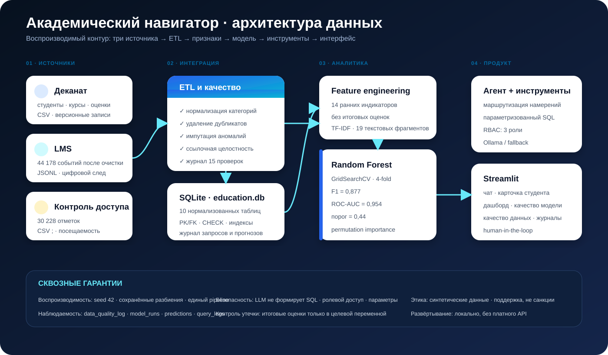

Архитектура разделена на шесть контуров.

1. **Источники.** Пять файлов имитируют три системы.
2. **ETL.** Модуль `src/etl.py` выполняет правила очистки и загружает SQLite в транзакции.
3. **Аналитический слой.** `src/features.py` создаёт модельную витрину, `src/eda.py` — статистики и графики.
4. **Текстовый слой.** `src/knowledge.py` разбивает Markdown на фрагменты, строит TF-IDF и выполняет cosine-поиск.
5. **ML.** `src/train.py` разделяет данные, подбирает модель, сохраняет артефакт и прогнозы.
6. **Продуктовый слой.** `src/tools.py` содержит разрешённые операции, `src/agent.py` — маршрутизацию и RBAC, `app.py` — Streamlit.

Реляционная БД является системой записи для фактов, признаков, прогнозов и журналов. Артефакты ML хранятся отдельно в Joblib/JSON, при этом таблица `model_runs` связывает версию с файлом. Такое разделение позволяет обновлять модель независимо от приложения и сохранять историю.

---

# 4. Этап 1. Сбор, очистка и интеграция данных

## 4.1. Источники

Выбран синтетический режим, поэтому «сбор» реализован воспроизводимым генератором. Это позволяет открыто публиковать репозиторий и намеренно создавать известные дефекты. Генератор использует скрытые переменные способности и учебной организованности, чтобы показатели имели правдоподобные связи, но не копировали реальных людей.

| Система | Файл | Формат | Сырых строк | Гранулярность |
|---|---|---:|---:|---|
| Деканат | `dean_students.csv` | CSV | 426 | студент |
| Деканат | `dean_courses.csv` | CSV | 6 | дисциплина |
| Деканат | `dean_grades.csv` | CSV | 2 600 | студент × дисциплина |
| Контроль доступа | `access_attendance.csv` | CSV `;` | 30 360 | посещение занятия |
| LMS | `lms_events.jsonl` | JSONL | 44 278 | цифровое событие |

В источники добавлены: лишние пробелы и разные тире в кодах групп, русские и английские категории, пропуски, возраст 130 лет, вступительный балл 155, повторные идентификаторы, старые версии ведомости, неизвестные статусы посещаемости, отрицательные длительности LMS.

Метаданные генерации включают seed, время и число строк. Синтетическое происхождение явно отмечено в README, отчёте и интерфейсе.

## 4.2. Правила очистки

ETL выполняет следующие преобразования.

1. Группа приводится к шаблону `ПИ-4XX`: регистр повышается, пробелы удаляются, длинное тире заменяется дефисом.
2. Пол нормализуется для описательной таблицы, но не используется моделью.
3. Возраст вне 17–65 и вступительный балл вне 0–100 переводятся в пропуск и заменяются медианой группы.
4. Карточки студентов дедуплицируются по `student_id`.
5. Версии ведомости сортируются по `exported_at`; остаётся самая свежая запись.
6. Статусы посещаемости отображаются в `present` и `late`; неизвестные значения отклоняются.
7. События LMS дедуплицируются по `event_id`; длительность восстанавливается медианой типа события и ограничивается диапазоном 0–120 минут.
8. Перед загрузкой проверяются допустимые студенты, курсы, типы событий и даты.
9. После загрузки выполняется `PRAGMA foreign_key_check`.

Фрагмент нормализации группы:

```python
def _normalise_group(value):
    text = str(value).upper().strip().replace("–", "-").replace("—", "-")
    text = re.sub(r"\s+", "", text)
    return re.sub(r"^ПИ-?(\d{3})$", r"ПИ-\1", text)
```

## 4.3. Результаты контроля качества

Выполнено 15 типов проверок. Сумма затронутых строк/значений равна 374; она не равна числу уникальных строк, поскольку одна строка может участвовать в нескольких проверках.

| Источник | Проблема | Количество | Действие |
|---|---|---:|---|
| students | дубликаты ID | 6 | оставлена последняя запись |
| students | возраст: пропуск/аномалия | 9 | медиана группы |
| students | вступительный балл: пропуск/аномалия | 7 | медиана группы |
| grades | версионные дубликаты | 80 | самая свежая запись |
| attendance | дубликаты отметок | 120 | последняя отметка |
| attendance | неизвестный статус | 12 | отклонение |
| LMS | дубликаты event_id | 100 | первое событие |
| LMS | пропуск/аномалия длительности | 40 | медиана типа события |

После очистки загружено 420 студентов, 6 дисциплин, 2 520 записей успеваемости, 30 228 отметок посещаемости и 44 178 событий LMS. Ошибок внешних ключей — 0.

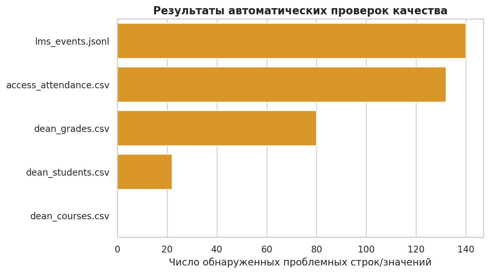

## 4.4. Схема базы данных

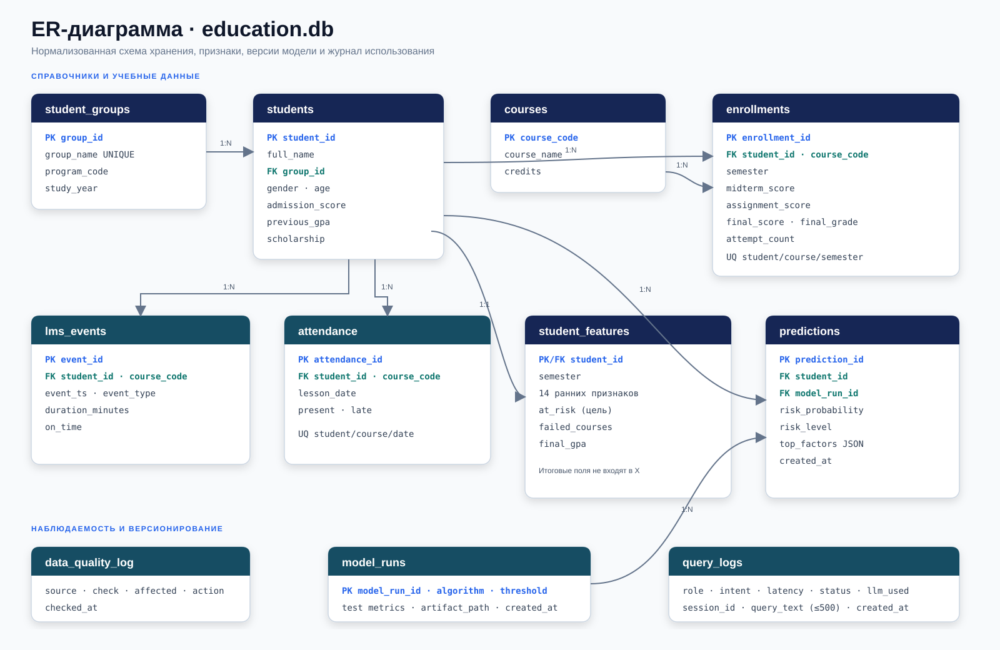

Нормализованные сущности:

- `student_groups` и `students` разделяют справочник группы и человека;
- `courses` и `enrollments` задают отношение многие-ко-многим студент–дисциплина с атрибутами семестра;
- `lms_events` и `attendance` хранят детальные факты;
- `student_features` является аналитической витриной 1:1 со студентом;
- `model_runs` и `predictions` обеспечивают версионирование;
- `data_quality_log` и `query_logs` обеспечивают наблюдаемость.

Ограничения `CHECK` не позволяют записать вероятность вне [0;1], оценку вне 2–5, недопустимый уровень риска или отрицательную длительность. Уникальные ограничения предотвращают повтор одной отметки и одной регистрации на дисциплину. Индексы созданы по внешним ключам, времени события и убывающей вероятности риска.

## 4.5. Транзакционность и идемпотентность

Схема пересоздаётся перед ETL, поэтому повторный полный запуск не накапливает дубликаты. Загрузка выполняется в одной транзакции: при ошибке изменения откатываются. Генератор с тем же seed воспроизводит те же исходные значения; временные метаданные и ID запуска модели закономерно меняются.

---

# 5. Этап 2. Разведочный анализ и подготовка признаков

## 5.1. Баланс цели

Из 420 студентов 145 (34,5%) имеют хотя бы одну неудовлетворительную итоговую оценку, 275 (65,5%) не имеют. Дисбаланс умеренный. Он учитывается стратификацией и `class_weight="balanced"`.

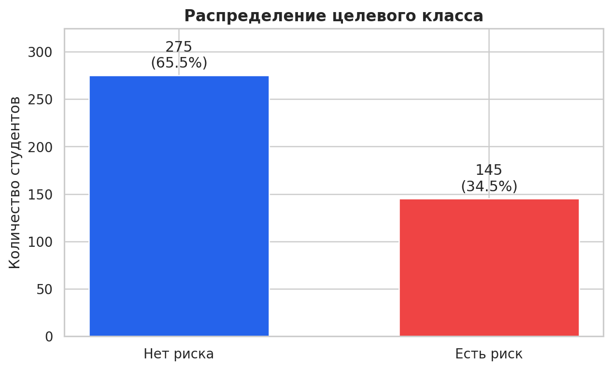

Доля риска по группам находится от 25,0% до 38,3%. Поскольку группы сформированы синтетически без специального эффекта, различия рассматриваются как выборочная вариация, а не как доказательство качества или проблем конкретной группы.

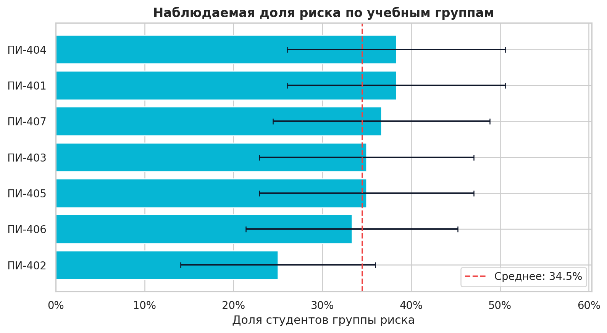

## 5.2. Описательные статистики

| Признак | Среднее | Медиана | Стандартное отклонение | Min | Max |
|---|---:|---:|---:|---:|---:|
| Исторический GPA | 3,503 | 3,540 | 0,593 | 2,000 | 5,000 |
| Посещаемость | 0,642 | 0,625 | 0,148 | 0,292 | 1,000 |
| Опоздания | 0,077 | 0,069 | 0,035 | 0,000 | 0,222 |
| События LMS / курс | 17,531 | 17,333 | 5,337 | 6,833 | 36,333 |
| Активные дни | 59,955 | 61,000 | 10,313 | 32 | 81 |
| Сдача вовремя | 0,619 | 0,632 | 0,170 | 0,000 | 1,000 |
| Промежуточный балл | 62,205 | 62,283 | 17,944 | 6,167 | 100 |
| Балл заданий | 70,067 | 70,492 | 14,997 | 25,683 | 100 |
| Среднее число попыток | 1,735 | 1,500 | 0,690 | 1,000 | 3,500 |

Распределения показывают ожидаемый сдвиг: у целевого класса ниже промежуточные результаты, исторический GPA и своевременность. Однако это ассоциации синтетического механизма генерации, а не причинные эффекты.

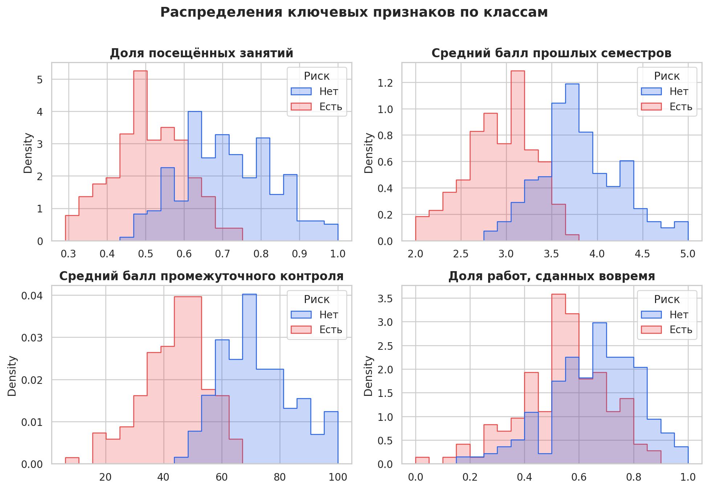

## 5.3. Корреляционный анализ

Для числовых признаков рассчитана ранговая корреляция Спирмена, устойчивая к нелинейной монотонной связи и форме распределения. Корреляционная матрица выявляет связанные показатели: активные дни и число событий LMS, промежуточные баллы и баллы заданий, посещаемость и своевременность. Сильная корреляция не используется как автоматическое основание удалить признак: Random Forest устойчивее линейных моделей к такой структуре, а permutation importance оценивается на отложенных данных.

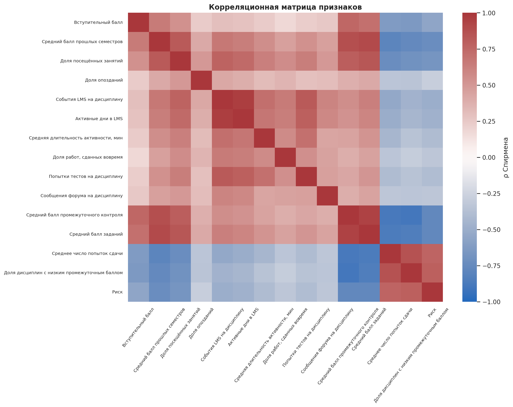

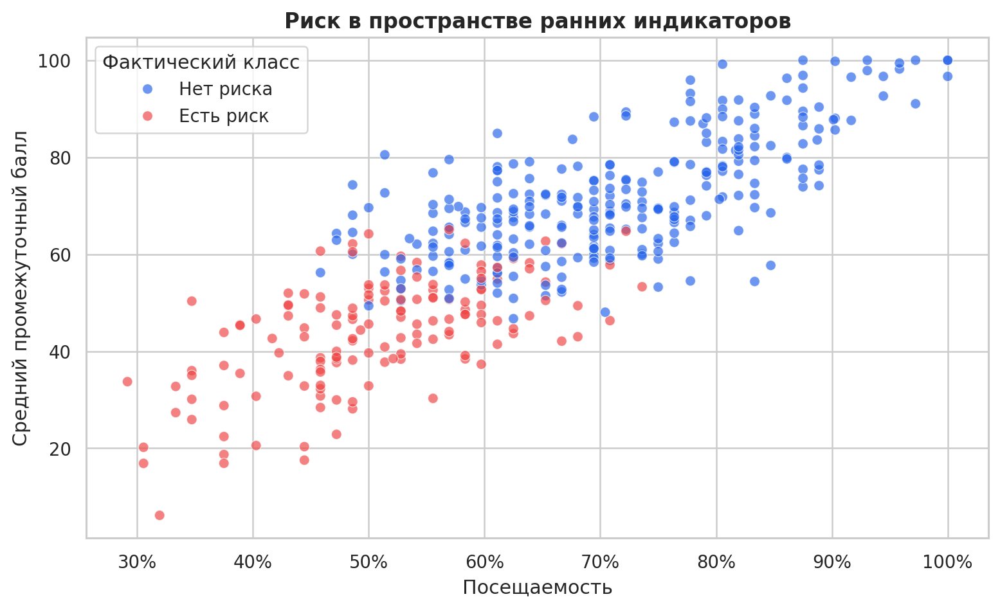

## 5.4. Feature engineering

Сформированы 14 признаков:

1. вступительный балл;
2. исторический GPA;
3. доля посещений;
4. доля опозданий;
5. события LMS на дисциплину;
6. активные дни;
7. средняя длительность активности;
8. доля заданий, сданных вовремя;
9. попытки тестов на дисциплину;
10. сообщения форума на дисциплину;
11. средний промежуточный балл;
12. средний балл заданий;
13. среднее число попыток сдачи;
14. доля дисциплин с промежуточным баллом ниже 50.

Пример SQL-агрегации LMS:

```sql
SELECT student_id,
       COUNT(*) AS lms_events,
       COUNT(DISTINCT substr(event_ts, 1, 10)) AS active_days,
       AVG(duration_minutes) AS avg_session_minutes,
       AVG(CASE WHEN event_type='assignment_submit' THEN on_time END)
           AS submission_on_time_rate
FROM lms_events
GROUP BY student_id;
```

Пол, возраст и стипендия не включены. Это уменьшает риск использования чувствительных или потенциально дискриминирующих прокси, хотя не гарантирует справедливость: остальные признаки также могут отражать структурные различия.

## 5.5. Предотвращение утечки

Итоговые поля `final_score`, `final_grade`, `failed_courses` и `final_gpa` доступны только после события, которое прогнозируется. Они исключены из `FEATURE_COLUMNS`. Промежуточные результаты и события ограничены ранней контрольной датой сценария. Автоматический тест проверяет отсутствие итоговых полей в списке признаков и отсутствие пропусков.

## 5.6. Текстовая база знаний и векторизация

Созданы пять Markdown-документов: регламент поддержки, рекомендации по учёбе, FAQ модели, приватность и качество данных. Разбиение выполняется по заголовкам второго уровня; получено 19 фрагментов. Векторизатор использует униграммы и биграммы, пользовательский список русских стоп-слов и sublinear term frequency. Словарь содержит 701 термин/фразу.

TF-IDF для терма \(t\) и документа \(d\):

\[
TFIDF(t,d)=TF(t,d)\cdot \log\frac{N}{DF(t)+1}.
\]

Векторы L2-нормированы, поэтому скалярное произведение равно cosine similarity. Для запроса выбираются три наиболее близких фрагмента выше минимального порога. В проекте это локальный лёгкий RAG-слой без сетевой передачи данных. Для большого корпуса целесообразны эмбеддинги предложений и специализированная векторная БД, но для 19 фрагментов TF-IDF проще, прозрачен и воспроизводим.

---

# 6. Этап 3. Построение и оценка моделей

## 6.1. Схема эксперимента

Наблюдения стратифицированно разделены:

- train — 252 (60%);
- validation — 84 (20%);
- test — 84 (20%).

Seed равен 42, назначения сохранены в `split_assignments.csv`. Train используется для обучения и внутренней кросс-валидации. Validation используется для выбора семейства модели и порога. Test не участвует в выборе и применяется один раз для итоговой оценки. После оценки выбранная конфигурация переобучается на train+validation для демонстрационных прогнозов; тестовые метрики остаются результатом модели до этого переобучения.

## 6.2. Модели-кандидаты

1. **DummyClassifier (`prior`)** — обязательная базовая линия, всегда использующая априорную долю класса.
2. **Logistic Regression** — интерпретируемая линейная модель со StandardScaler и `class_weight="balanced"`.
3. **Random Forest** — ансамбль деревьев, позволяющий описывать нелинейные взаимодействия и не требующий масштабирования [5].

Для Random Forest выполнен GridSearchCV:

- `max_depth`: 4, 7, None;
- `min_samples_leaf`: 2, 5;
- `max_features`: sqrt, 0,8;
- 12 комбинаций;
- 4 стратифицированных fold;
- критерий выбора — F1.

Лучшая конфигурация: `max_depth=4`, `min_samples_leaf=5`, `max_features="sqrt"`; средний CV F1 = 0,8833.

## 6.3. Метрики

Поскольку ошибка пропуска нуждающегося в поддержке студента важна, анализируется recall. Одновременно чрезмерное число ложных сигналов перегружает сотрудников, поэтому нужен precision. F1 балансирует эти метрики:

\[
Precision=\frac{TP}{TP+FP},\quad Recall=\frac{TP}{TP+FN},
\]

\[
F1=2\cdot\frac{Precision\cdot Recall}{Precision+Recall}.
\]

ROC-AUC измеряет ранжирование по всем порогам [6], Average Precision полезна при дисбалансе, Brier score оценивает среднеквадратичную ошибку вероятности (меньше — лучше).

## 6.4. Результаты на validation

| Модель | Accuracy | Precision | Recall | F1 | ROC-AUC | Brier |
|---|---:|---:|---:|---:|---:|---:|
| DummyClassifier | 0,655 | 0,000 | 0,000 | 0,000 | 0,500 | 0,226 |
| Logistic Regression | 0,893 | 0,813 | 0,897 | 0,853 | 0,970 | 0,069 |
| Random Forest | 0,905 | 0,862 | 0,862 | **0,862** | **0,976** | **0,065** |

По правилу максимума F1 выбран Random Forest. На validation найден порог 0,44, при котором F1 = 0,8852.

## 6.5. Итоговая оценка на test

| Метрика | Значение |
|---|---:|
| Accuracy | 0,9167 |
| Precision | 0,8929 |
| Recall | 0,8621 |
| F1 | **0,8772** |
| ROC-AUC | **0,9542** |
| Average Precision | 0,9341 |
| Brier score | 0,0768 |

Матрица ошибок `[[TN, FP], [FN, TP]] = [[52, 3], [4, 25]]`. Из 29 положительных случаев обнаружено 25, четыре пропущено; три случая отмечены ошибочно.

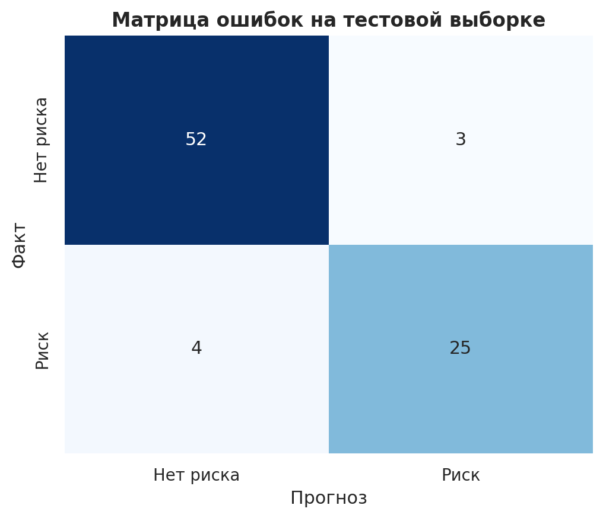

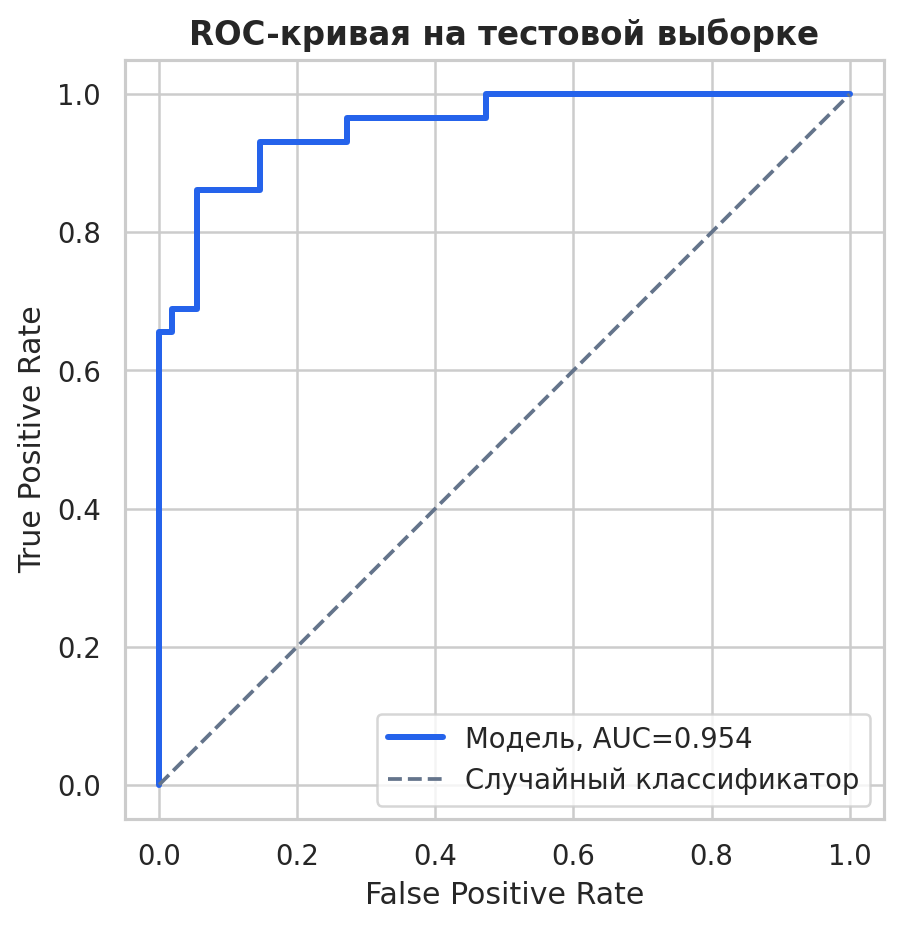

Высокие показатели ожидаемы для синтетического набора, поскольку целевая переменная порождена теми же скрытыми факторами, что и признаки. Они подтверждают правильность конвейера, но не являются оценкой внешней обобщающей способности.

## 6.6. Интерпретация

Permutation importance измеряет падение F1 при случайной перестановке признака на test. Наиболее значимы средний балл заданий, среднее число попыток, попытки тестов, исторический GPA и промежуточный балл.

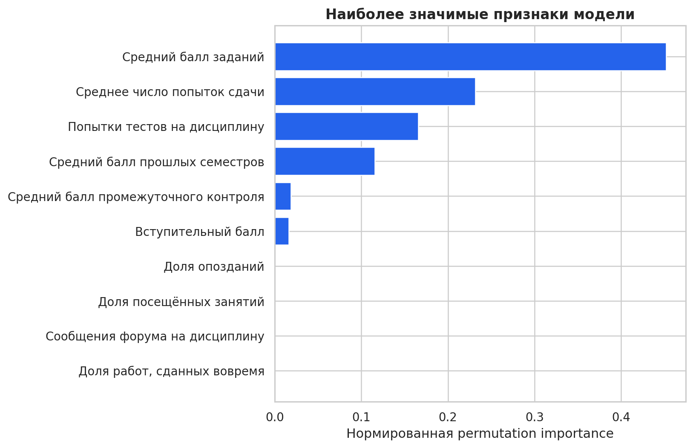

Для индивидуальной карточки глобальная значимость умножается на стандартизованное отклонение значения от медианы и знак связи с целевым классом. Выбираются три положительных вклада. Метод прост и пригоден для интерфейса, но не является точным SHAP-разложением и не доказывает причинность.

## 6.7. Версионирование модели

Joblib-артефакт содержит pipeline, порядок признаков, порог, алгоритм, время, медианы, IQR, направления и значимости. Таблица `model_runs` хранит ID запуска и тестовые метрики; `predictions` ссылается на ID запуска. Карточка модели документирует назначение, данные, метрики и ограничения. Это предотвращает ситуацию, когда приложение показывает прогноз неизвестной версии.

---

# 7. Интеллектуальный агент и база знаний

## 7.1. Подход «инструменты прежде генерации»

Свободный SQL от LLM создаёт риски ошибок, утечки и инъекции. Поэтому реализован ограниченный набор функций:

- `overview()` — общая сводка;
- `student_card(student_id)` — карточка студента;
- `group_summary(group_name)` — агрегаты группы;
- `high_risk_students(limit, group)` — приоритетный список;
- `course_analysis()` — аналитика дисциплин;
- `model_quality()` — сохранённые метрики;
- `knowledge_search(query)` — поиск по регламентам.

Маршрутизатор намерений извлекает только допустимые параметры. SQL использует placeholders, а лимит ограничен диапазоном 1–50. LLM получает не БД, а готовый JSON и проверенный черновик.

## 7.2. Ролевой контроль

Студент может запросить только собственный ID. Попытка открыть другую карточку или список возвращает `forbidden`. Преподаватель и деканат получают агрегаты и списки; техническая активность показана только деканату. В реальной системе роль и область полномочий должны поступать из SSO; интерфейсный select является только демонстрацией.

## 7.3. Промпт-инжиниринг

Системный промпт требует:

- использовать только контекст инструмента;
- не изменять числа;
- называть прогноз вероятностным;
- не делать медицинских и психологических выводов;
- не использовать защищённые характеристики как причину;
- предлагать поддерживающие действия;
- соблюдать роль;
- сообщать о недостатке данных.

Температура Ollama установлена 0,15. Добавлены few-shot примеры, включая отказ отвечать на запрос «Кого отчислить?». Поскольку платный API не допускается, рекомендована локальная модель `qwen2.5:3b`. Если Ollama отключена или недоступна, используется шаблонный NLG: числа и все функции сохраняются.

## 7.4. RAG по внутренним документам

Для вопросов о поддержке, приватности, интерпретации и качестве данных агент вызывает TF-IDF-поиск и цитирует найденные секции с именами файлов. Такой RAG не генерирует новые регламенты, а возвращает локальные фрагменты. В продуктивном варианте документы должны иметь владельца, дату действия, версию и утверждённый статус.

## 7.5. Журналирование

Для каждого запроса сохраняются UTC-время, session ID, роль, намерение, текст до 500 символов, задержка, число результатов, статус и факт LLM. Ограничение длины препятствует превращению журнала в неконтролируемое хранилище диалогов. Для реального внедрения требуется дополнительная псевдонимизация и политика удаления.

---

# 8. Этап 4. Развёртывание и визуализация

## 8.1. Выбор Streamlit

Streamlit выбран потому, что позволяет объединить пользовательский интерфейс, Plotly-графики и Python-аналитику без отдельного фронтенда. Для лабораторного прототипа это снижает сложность развёртывания. SQLite обеспечивает переносимость одного файла. Ограничение такого выбора — отсутствие встроенной промышленной аутентификации и горизонтального масштабирования.

## 8.2. Структура интерфейса

Приложение содержит вкладки:

1. **Агент** — чат и быстрые запросы;
2. **Карточка** — gauge вероятности, ранние показатели, факторы и действия;
3. **Дашборд** — распределение уровней, сравнение групп, scatter индикаторов, список;
4. **Модель** — метрики, ROC, confusion matrix, значимости и сравнение кандидатов;
5. **Качество данных** — число проверок, график и детальный журнал;
6. **О проекте** — архитектура, ERD и принципы.

Цвет не является единственным носителем смысла: уровень подписан текстом и процентом. Таблицы доступны для проверки точных значений.

## 8.3. Запуск

```bash
python -m venv .venv
source .venv/bin/activate      # Windows: .venv\Scripts\activate
pip install -r requirements.txt
python scripts/run_pipeline.py
streamlit run app.py
```

Конфигурация связывает сервер с `0.0.0.0:8501`. Готовые БД и модель включены, но полный pipeline рекомендуется выполнить для проверки воспроизводимости.

## 8.4. Наблюдаемость

Дашборд читает последний `model_run_id`, поэтому новая версия автоматически становится активной. Техническая панель агрегирует число запросов, среднюю задержку, успешность и применение LLM по дням. Журнал качества показывает не только число проблем, но и действие. Такой подход связывает наблюдаемость данных, модели и приложения.

---

# 9. Тестирование и оценка прототипа

## 9.1. Автоматические тесты

Набор pytest проверяет:

- наличие достаточного числа записей и отсутствие ошибок внешних ключей;
- отсутствие пропусков в 14 признаках;
- отсутствие итоговых полей среди признаков;
- наличие двух классов;
- работу сохранённого pipeline и диапазон вероятностей;
- запрет студенту читать другую карточку;
- доступ общей сводки и своей карточки;
- релевантный поиск по текстовой базе.

Контрольный запуск: **9 тестов пройдено** (число следует актуализировать автоматически при изменении состава).

## 9.2. Контрольные диалоговые сценарии

Для маршрутизатора подготовлено 23 формулировки семи намерений: общая сводка, карточка, группа, список, дисциплины, модель, база знаний и справка. На контрольном наборе корректно классифицировано 23 из 23, accuracy = 1,000. Набор небольшой и составлен разработчиком, поэтому результат не заменяет тестирование на реальных формулировках.

## 9.3. Время отклика

Выполнено 60 вызовов шести типовых инструментов в шаблонном режиме на локальной SQLite:

| Показатель | Задержка |
|---|---:|
| Средняя | 6,266 мс |
| Медиана | 3,142 мс |
| P95 | 18,063 мс |
| Максимум | 22,915 мс |
| Успешные запросы | 60 из 60 |

Измерение не включает холодный старт Streamlit, браузерную отрисовку и генерацию Ollama. Задержка LLM зависит от аппаратного обеспечения и размера модели и должна измеряться отдельно в целевой среде.

## 9.4. Проверка безопасности

- строка, похожая на SQL-инъекцию, не попадает в SQL, поскольку намерение выбирает фиксированный запрос;
- параметры `student_id` и `group_name` передаются placeholders;
- лимит приводится к целому и ограничивается 50;
- LLM не получает объект connection и не вызывает Python;
- студенту запрещены списки и чужие карточки;
- при ошибке пользователю не показывается трассировка.

## 9.5. Критерии выполнения задания

| Требование | Реализация |
|---|---|
| Не менее двух источников | 3 системы, 5 файлов |
| ETL и очистка | `generate_data.py`, `etl.py`, журнал 15 проверок |
| Реляционная БД | SQLite, 10 таблиц, ERD |
| Векторное представление | TF-IDF, 5 документов, 19 фрагментов |
| EDA и признаки | 14 признаков, 9 графиков |
| Baseline и модели | Dummy, Logistic Regression, Random Forest |
| Подбор гиперпараметров | GridSearchCV, 12 комбинаций, 4-fold |
| Интерфейс | Streamlit, чат и карточка |
| Дашборд | группы, уровни, scatter, качество |
| Логирование | `data_quality_log`, `model_runs`, `predictions`, `query_logs` |
| README и requirements | включены |
| Отчёт и презентация | включены в `reports/` |

---

# 10. Ограничения, этика и направления развития

## 10.1. Ограничения эксперимента

1. **Синтетические данные.** Они полезны для отладки, но упрощают реальные зависимости и дают оптимистичные метрики.
2. **Одно временное сечение.** Нет проверки на следующем учебном году и дрейфе.
3. **Случайное разбиение.** Для реального внедрения предпочтительна временная и межкогортная валидация.
4. **Калибровка.** Brier рассчитан, но reliability diagram и отдельная калибровка не выполнены.
5. **Объяснения.** Приближённый метод не заменяет SHAP и причинный анализ.
6. **TF-IDF.** Лексический поиск хуже понимает синонимы, чем эмбеддинги.
7. **RBAC-демонстрация.** Нет SSO, реального распределения преподавателей по группам и шифрования.
8. **LLM.** Качество конкретной Ollama-модели не оценено систематически; шаблонный режим является эталонным fallback.

## 10.2. Этические риски

Ложноположительный прогноз может стигматизировать студента; ложноотрицательный — лишить своевременной помощи. Активность LMS неполна: чтение книг и совместная работа офлайн не видны. Посещаемость может отражать здоровье, работу, доступность транспорта и ошибки учёта, поэтому её нельзя интерпретировать как мотивацию. Даже исключение пола и возраста не устраняет косвенные прокси.

В соответствии с подходом NIST AI RMF [12] управление риском должно охватывать постановку цели, измерение, управление и постоянное наблюдение. Прогноз должен инициировать проверку данных и разговор, а не автоматическое решение. Студенту необходимы уведомление, понятное объяснение, возможность исправить данные и обжаловать затрагивающее его решение.

## 10.3. Требования перед реальным пилотом

- определить правовое основание и цель обработки;
- провести DPIA и согласовать локальные акты;
- заменить ФИО псевдонимами в аналитическом контуре;
- внедрить SSO, минимальные права, аудит и шифрование;
- определить сроки хранения и удаление журналов;
- обучить модель на легитимных исторических данных;
- провести временную и внешнюю валидацию;
- проверить recall, false positive rate и калибровку по допустимым группам;
- оценить полезность вмешательства, а не только точность прогноза;
- создать комиссию/владельца модели и процедуру остановки;
- мониторить пропуски, сдвиг признаков, калибровку и ошибки.

## 10.4. Направления развития

1. перейти на PostgreSQL и миграции Alembic;
2. разделить FastAPI backend и frontend;
3. организовать инкрементальную загрузку и оркестрацию Airflow/Prefect;
4. хранить feature snapshots с event time для строгого point-in-time join;
5. добавить MLflow для экспериментов и model registry;
6. применить calibrated classifier и интервалы неопределённости;
7. внедрить SHAP с понятными ограничениями;
8. заменить TF-IDF на русскоязычные sentence embeddings и векторное хранилище;
9. добавить гибридный поиск, версии и даты действия документов;
10. провести A/B или квазиэксперимент по эффективности мер поддержки;
11. реализовать мониторинг data drift, concept drift и fairness;
12. добавить Telegram-бот или интеграцию с LMS при сохранении единого слоя инструментов.

---

# 11. Заключение

В ходе комплекса лабораторных работ реализован полный цикл управления данными для интеллектуального образовательного приложения. Сформированы и интегрированы три разнородных источника, устранены контролируемые дефекты, спроектирована нормализованная SQLite-БД и ER-диаграмма. Журнал качества делает очистку наблюдаемой, а ограничения схемы обеспечивают целостность.

EDA и feature engineering привели данные к витрине из 14 ранних признаков. Итоговые результаты отделены от входа модели. Сравнение baseline, логистической регрессии и случайного леса выполнено на зафиксированном разбиении. Выбранный Random Forest после GridSearchCV получил на test F1 0,877 и ROC-AUC 0,954. Корректная интерпретация результата ограничена синтетическим набором.

Для текстовой информации построен TF-IDF-индекс локальной базы знаний. Агент реализует принцип «инструменты прежде генерации»: проверяет роль, вызывает параметризованный инструмент и только затем формирует ответ. Опциональная Ollama не является источником чисел; при её отсутствии работает детерминированный fallback. Streamlit-приложение объединяет диалог, карточку, дашборд, модельные метрики и контроль качества.

Таким образом, цель достигнута: создан воспроизводимый работающий прототип, демонстрирующий сбор, очистку, интеграцию, хранение, анализ, моделирование и представление данных. Главный вывод состоит в том, что качество интеллектуального агента определяется не только выбранным алгоритмом, но и происхождением данных, временной корректностью признаков, ограничениями доступа, наблюдаемостью и регламентом человеческого решения.

---

# 12. Список использованных источников

1. DAMA International. *DAMA-DMBOK: Data Management Body of Knowledge*. 2nd ed. Technics Publications, 2017.
2. Kimball R., Caserta J. *The Data Warehouse ETL Toolkit*. Wiley, 2004.
3. Han J., Kamber M., Pei J. *Data Mining: Concepts and Techniques*. 3rd ed. Morgan Kaufmann, 2011.
4. Provost F., Fawcett T. *Data Science for Business*. O’Reilly Media, 2013.
5. Breiman L. Random Forests // *Machine Learning*. 2001. Vol. 45. P. 5–32. DOI: 10.1023/A:1010933404324.
6. Fawcett T. An introduction to ROC analysis // *Pattern Recognition Letters*. 2006. Vol. 27(8). P. 861–874. DOI: 10.1016/j.patrec.2005.10.010.
7. Pedregosa F. et al. Scikit-learn: Machine Learning in Python // *Journal of Machine Learning Research*. 2011. Vol. 12. P. 2825–2830.
8. Buitinck L. et al. API design for machine learning software: experiences from the scikit-learn project // *ECML PKDD Workshop*. 2013.
9. Lewis P. et al. Retrieval-Augmented Generation for Knowledge-Intensive NLP Tasks // *NeurIPS*. 2020. Vol. 33. P. 9459–9474.
10. Salton G., Buckley C. Term-weighting approaches in automatic text retrieval // *Information Processing & Management*. 1988. Vol. 24(5). P. 513–523.
11. Sculley D. et al. Hidden Technical Debt in Machine Learning Systems // *NeurIPS*. 2015. P. 2503–2511.
12. NIST. *Artificial Intelligence Risk Management Framework (AI RMF 1.0)*. NIST AI 100-1, 2023. DOI: 10.6028/NIST.AI.100-1.
13. Федеральный закон РФ от 27.07.2006 № 152-ФЗ «О персональных данных» (действующая редакция должна быть проверена перед внедрением).
14. SQLite Documentation. Foreign Key Support, CREATE TABLE, Indexes. URL: https://sqlite.org/docs.html (дата обращения: 28.09.2026).
15. Scikit-learn User Guide. Model selection and evaluation; RandomForestClassifier; GridSearchCV. URL: https://scikit-learn.org/stable/user_guide.html (дата обращения: 28.09.2026).
16. Streamlit Documentation. URL: https://docs.streamlit.io/ (дата обращения: 28.09.2026).
17. Plotly Python Documentation. URL: https://plotly.com/python/ (дата обращения: 28.09.2026).
18. Ollama Documentation. URL: https://docs.ollama.com/ (дата обращения: 28.09.2026).
19. Python Software Foundation. Python 3 Documentation. URL: https://docs.python.org/3/ (дата обращения: 28.09.2026).
20. McKinney W. *Python for Data Analysis*. 3rd ed. O’Reilly Media, 2022.

---

# Приложение А. Структура репозитория

```text
edu-risk-agent/
├── app.py
├── src/
│   ├── config.py
│   ├── db.py
│   ├── generate_data.py
│   ├── etl.py
│   ├── schema.sql
│   ├── features.py
│   ├── knowledge.py
│   ├── train.py
│   ├── eda.py
│   ├── tools.py
│   └── agent.py
├── scripts/
│   ├── run_pipeline.py
│   └── evaluate_agent.py
├── data/{raw,processed}
├── knowledge/
├── models/
├── prompts/
├── docs/
├── reports/figures/
├── tests/
├── requirements.txt
└── README.md
```

# Приложение Б. Команды воспроизведения

```bash
pip install -r requirements-dev.txt
python scripts/run_pipeline.py
python scripts/evaluate_agent.py
pytest
streamlit run app.py
```

# Приложение В. Примеры запросов

```text
Покажи общую сводку.
Какой риск у STU0001?
Сводка по группе ПИ-401.
Покажи топ 5 студентов с высоким риском.
Какие дисциплины самые сложные?
Какое качество модели?
Как организована ранняя академическая поддержка?
Как интерпретировать вероятность риска?
```

# Приложение Г. Чек-лист перед защитой

- [ ] заполнить название вуза, кафедру, ФИО, группу и руководителя;
- [ ] заменить URL репозитория в README;
- [ ] выполнить pipeline на машине демонстрации;
- [ ] выполнить `pytest`;
- [ ] запустить Streamlit и проверить роли;
- [ ] показать сырые дефекты и `data_quality_log`;
- [ ] объяснить отсутствие утечки итоговых оценок;
- [ ] назвать различие порога 0,44 и уровней 35/65%;
- [ ] подчеркнуть синтетическую природу и human-in-the-loop;
- [ ] подготовить ответ о внешней валидации и дрейфе.
